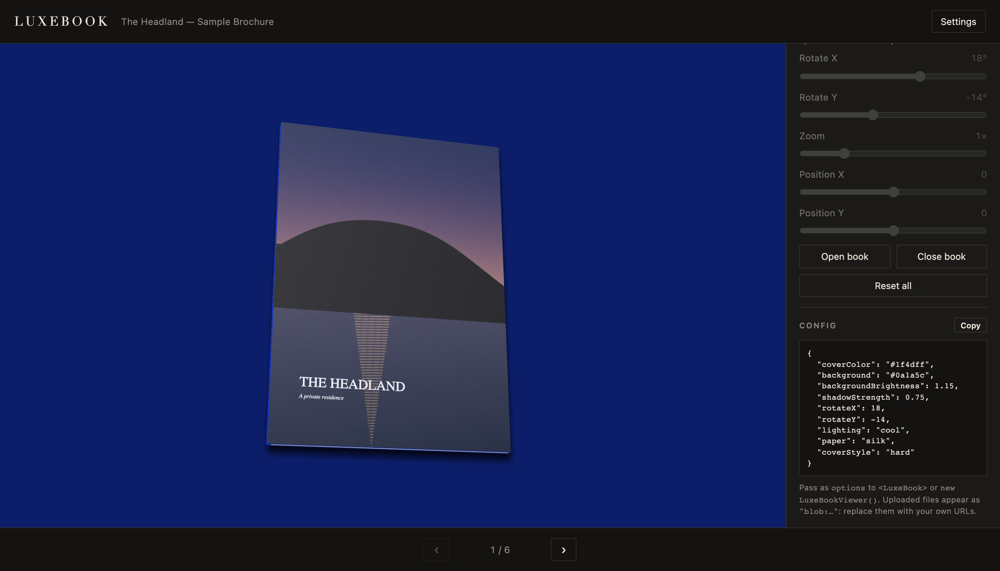

<div align="center">

# 📖 Luxebook

### Turn any PDF into a real 3D book. One line of code.

Hard covers, paper thickness, glossy pages that catch the light, and page turns you can grab by the corner.<br/>
Free, open source, no watermark. React or plain JavaScript.

[](https://www.npmjs.com/package/@vectoad/luxebook-react)
[](https://www.npmjs.com/package/@vectoad/luxebook-core)
[](https://github.com/Vectoad/luxebook)
[](https://github.com/Vectoad/luxebook/blob/main/packages/types/src/index.ts)
[](https://github.com/Vectoad/luxebook/blob/main/LICENSE)

**[✨ Live demo](https://vectoad.github.io/luxebook/)** · **[Quick start](#-quick-start)** · **[Design your book](#-design-your-book-visually)** · **[Recipes](#-recipes)** · **[API](#-api-reference)** · **[FAQ](#-faq)**

<a href="https://vectoad.github.io/luxebook/"></a>

<sub>☝️ That's a regular PDF. No conversion, no server, no SaaS.</sub>

</div>

---

## Why Luxebook?

Flat PDF embeds look like a scanned photocopy. Flipbook tools are paid SaaS with a watermark and an iframe. Luxebook renders **your PDF as a physical object**, on your own site.

|  |  |
| --- | --- |
| 🎨 **Looks real** | True 3D geometry: page-stack thickness, cover boards, spine, soft shadows on the table. |
| ✋ **Feels real** | Hover a corner and it lifts. Drag it and the page bends under your cursor. |
| 💡 **Lighting & paper** | `neutral` · `warm` · `cool` · `dramatic` light on `matte` · `silk` · `glossy` stock. |
| 📕 **Soft or hard cover** | A paperback cover that folds like a page, or a stiff board that swings on its hinge. |
| 🎬 **Cinematic states** | Show the closed book tilted and off-centre; it glides to the centre as it opens. |
| 📱 **Mobile-ready** | Two-page spreads on desktop, one page on portrait screens, switching live on rotate. |
| 🔍 **Reading zoom** | Double-click a page for crisp small print, re-rendered at higher resolution. |
| 🧩 **Your UI on a page** | Put live React or HTML (a lead form, a CTA, a video) onto any page, in perspective. |
| 🔒 **Preview mode** | `lastPage: 4` ends the book early with a "get the full brochure" page. |
| ⚡ **Fast** | Progressive rendering, on-demand pages with a small preload window, SSR-safe, code-split. |
| 🎛️ **Visual config builder** | Tune everything with sliders in the playground, then copy the config. |
| 🟦 **Typed** | Every option documented in your editor. |

---

## 🚀 Quick start

### React

```sh
npm install @vectoad/luxebook-react
```

```tsx
import { LuxeBook } from "@vectoad/luxebook-react";

export default function Brochure() {
  return <LuxeBook source="/brochure.pdf" height={600} />;
}
```

Works in any React 18 app: Next.js (App and Pages Router), Vite, Remix. The component is SSR-safe: Three.js and PDF.js load in the browser only, in their own chunk.

### Vanilla JS, Vue, Svelte, Angular, anything

```sh
npm install @vectoad/luxebook-core
```

```ts
import { LuxeBookViewer } from "@vectoad/luxebook-core";

const book = new LuxeBookViewer(document.getElementById("book")!);
await book.load("/brochure.pdf");
```

Give the container a size (`#book { height: 600px }`), and you're done. No API key, no hosting, no watermark.

---

## 🎛️ Design your book visually

Don't guess numbers. **Open the playground, drag sliders until it looks right, and click Copy.** The Config box shows only what differs from the defaults, so you paste a short object straight into `options`.

<a href="https://vectoad.github.io/luxebook/"></a>

**Option 1: online.** Go to the **[live playground](https://vectoad.github.io/luxebook/)**, drop your own PDF on the book, and style it.

**Option 2: on your machine.** Run the playground locally, then use your real PDFs and cover images:

```sh
git clone https://github.com/Vectoad/luxebook.git
cd luxebook
pnpm install
pnpm dev          # opens the playground at http://localhost:5173
```

Then:

1. **Upload PDF** (or drag one onto the book).
2. Pick a **preset**, then tweak lighting, paper, cover, thickness, angle, zoom, background.
3. Set a separate **closed-book pose** and click **Open book** / **Close book** to preview the animation.
4. Click **Copy** in the **Config** panel and paste it into your code:

```tsx
<LuxeBook
  source="/brochure.pdf"
  options={{
    // pasted from the playground 👇
    coverColor: "#1f4dff",
    background: "#0a1a5c",
    backgroundBrightness: 1.15,
    shadowStrength: 0.75,
    rotateX: 18,
    rotateY: -14,
    lighting: "cool",
    paper: "silk",
    coverStyle: "hard",
  }}
/>
```

> Uploaded files show up as `"blob:…"` in the config. Replace them with your own URLs.

The playground also reads URL parameters, handy for sharing a look with your team:

| Parameter | Example | Effect |
| --- | --- | --- |
| `src` | `?src=https://example.com/catalog.pdf` | Load any PDF URL (the server must allow CORS) |
| `paper` | `?paper=matte` | Paper finish |
| `coverStyle` | `?coverStyle=hard` | Cover style |
| `layout` | `?layout=single` | Force one page or two |
| `lastPage` | `?lastPage=4` | Preview mode |
| `cover` | `?cover=0` | Start at page 1 \| page 2, with no closed cover |
| `form` | `?form=0` | Hide the demo contact form |
| `shadows` | `?shadows=0` | Turn off shadows |

---

## 🎨 Presets

Six ready-made looks. Spread one in, then override anything:

```tsx
import { LuxeBook, PRESETS } from "@vectoad/luxebook-react";

<LuxeBook source="/book.pdf" options={{ ...PRESETS.night, paper: "matte" }} />
```

| Preset | Look |
| --- | --- |
| `studio` | True colour on a soft dark backdrop. The default. |
| `gallery` | Bright and airy: a book on a white gallery table. |
| `classic` | Warm paper under a reading lamp. |
| `night` | Strong spotlight, deep shadow, slight angle. |
| `electric` | Cool light on deep electric blue, tilted for depth. |
| `showcase` | Product-shot angle on neutral grey. |

---

## 🍳 Recipes

<details open>
<summary><b>Lead capture: a form on the last page</b></summary>

The overlay is live React, so state, inputs and handlers all work. It sits on the page in perspective and hides while that page turns.

```tsx
<LuxeBook
  source="/villa.pdf"
  overlayPage="end" // or a page number
  overlay={
    <form onSubmit={sendLead}>
      <h3>Request a viewing</h3>
      <input name="email" type="email" placeholder="Email" required />
      <button>Send</button>
    </form>
  }
/>
```

Vanilla: `viewer.setOverlay(element, { page: "end" })`.

</details>

<details>
<summary><b>Preview mode: show the first pages, gate the rest</b></summary>

```tsx
<LuxeBook
  source="/full-catalog.pdf"
  options={{ lastPage: 4 }}
  overlay={<a href="/signup">Get the full catalogue →</a>}
/>
```

The book ends after page 4, followed by one blank page that holds your `"end"` overlay.

</details>

<details>
<summary><b>Product-shot pose that straightens as it opens</b></summary>

```tsx
options={{
  coverStyle: "hard",
  states: {
    closed: { rotateX: 28, rotateY: -22, offsetX: 0.35, zoom: 0.8 },
    open: { rotateX: 0, rotateY: 0, offsetX: 0, zoom: 1 },
  },
}}
```

Values blend smoothly while the book opens and closes, and the pose returns when it closes.

</details>

<details>
<summary><b>Custom cover image and colour</b></summary>

```tsx
options={{ cover: { image: "/cover.jpg" }, coverColor: "#4a2f1f", coverThickness: 1.6, spineWidth: 1.2 }}
```

`cover` can also be `"first-page"` (default) or `"plain"`.

</details>

<details>
<summary><b>Your own buttons, page counter and keyboard</b></summary>

```tsx
const book = useRef<LuxeBookHandle>(null);
const [label, setLabel] = useState("");

<LuxeBook ref={book} source="/book.pdf" onPageChange={(e) => setLabel(`${e.page} / ${e.pageCount}`)} />
<button onClick={() => book.current?.previous()}>‹</button>
<span>{label}</span>
<button onClick={() => book.current?.next()}>›</button>
```

</details>

<details>
<summary><b>Take over clicks (open a lightbox, track analytics)</b></summary>

```tsx
<LuxeBook
  source="/book.pdf"
  onBookClick={(e) => {
    if (e.target === "page") {
      e.preventDefault();        // don't turn the page
      openLightbox(e.page);
    }
  }}
  onPageChange={(e) => analytics.track("page_view", { page: e.page })}
/>
```

</details>

<details>
<summary><b>Mobile: one page at a time</b></summary>

The default `layout: "auto"` already shows one page when the viewer is taller than it is wide, and switches live when the phone rotates. Force it with `layout: "single"` or `layout: "double"`.

</details>

<details>
<summary><b>Load PDF bytes (uploads, auth-protected files)</b></summary>

```ts
const bytes = await fetch("/api/private.pdf", { headers: { Authorization: token } }).then((r) => r.arrayBuffer());
<LuxeBook source={bytes} />
```

`source` accepts a URL string, a `URL`, an `ArrayBuffer` or a `Uint8Array`. Changing it loads the new document into the same viewer.

</details>

---

## 🧱 Framework guides

<details>
<summary><b>Next.js</b></summary>

App Router: the component ships with `"use client"`, so use it directly in a page or component.

```tsx
import { LuxeBook } from "@vectoad/luxebook-react";

export default function Page() {
  return <LuxeBook source="/brochure.pdf" height="100vh" />;
}
```

Pages Router: see the [full example](https://github.com/Vectoad/luxebook/tree/main/examples/nextjs-pages-router).

</details>

<details>
<summary><b>Vue 3</b></summary>

```vue
<script setup lang="ts">
import { onMounted, onBeforeUnmount, ref } from "vue";
import { LuxeBookViewer } from "@vectoad/luxebook-core";

const el = ref<HTMLDivElement>();
let viewer: LuxeBookViewer | undefined;

onMounted(() => {
  viewer = new LuxeBookViewer(el.value!, { lighting: "warm" });
  viewer.load("/brochure.pdf");
});
onBeforeUnmount(() => viewer?.destroy());
</script>

<template><div ref="el" style="height: 600px" /></template>
```

</details>

<details>
<summary><b>Svelte</b></summary>

```svelte
<script lang="ts">
  import { onMount } from "svelte";
  import { LuxeBookViewer } from "@vectoad/luxebook-core";

  let el: HTMLDivElement;
  onMount(() => {
    const viewer = new LuxeBookViewer(el, { paper: "matte" });
    viewer.load("/brochure.pdf");
    return () => viewer.destroy();
  });
</script>

<div bind:this={el} style="height: 600px"></div>
```

</details>

---

## 📚 API reference

### `<LuxeBook>` props

| Prop | Type | Default | |
| --- | --- | --- | --- |
| `source` | `string \| URL \| ArrayBuffer \| Uint8Array` | required | The PDF. Changing it loads a new document. |
| `width` / `height` | `number \| string` | `"100%"` / `600` | Size of the viewer. |
| `options` | `ViewerOptions` | | Everything below. Appearance options update live. |
| `overlay` | `ReactNode` | | Your content, laid on a page. |
| `overlayPage` | `number \| "end"` | `"end"` | Which page the overlay sits on. |
| `onReady` | `(info: DocumentInfo) => void` | | PDF loaded: page count, title, author, sizes. |
| `onPageChange` | `(e: PageChangeEvent) => void` | | `{ page, pageCount, spread }`. |
| `onBookStateChange` | `(state) => void` | | `"opening" \| "open" \| "closing" \| "closed"`. |
| `onBookClick` | `(e: BookClickEvent) => void` | | Target: `"page" \| "cover" \| "book" \| "background"`. Call `e.preventDefault()` to skip the default action. |
| `onReadingZoomChange` | `(scale: number) => void` | | `1` when zoomed out. |
| `onError` | `(e: LuxeBookError) => void` | | See [errors](#errors). |
| `className` / `style` | | | On the container. |

### Ref handle

```ts
book.current.next();
book.current.previous();
book.current.goToPage(12);
book.current.open();          // animated
book.current.close();         // animated
book.current.zoomTo(2);       // reading zoom; zoomTo(1) zooms out
book.current.viewer;          // the underlying LuxeBookViewer
```

### `LuxeBookViewer` (core)

```ts
const viewer = new LuxeBookViewer(container, options);

await viewer.load(source);              // → DocumentInfo
viewer.setOptions({ lighting: "warm" }); // live appearance changes
viewer.setOverlay(element, { page: "end" });
viewer.next(); viewer.previous(); viewer.goToPage(n);
viewer.open(); viewer.close();
viewer.zoomIn(); viewer.zoomOut(); viewer.resetZoom(); viewer.zoomTo(scale);
viewer.state;                           // { status, bookState, pageCount, spread, layout }
viewer.snapshot();                      // current frame as a canvas
viewer.destroy();

const off = viewer.on("pagechange", (e) => {}); // returns an unsubscribe function
```

Events: `ready`, `pagechange`, `bookstate`, `click`, `readingzoom`, `error`.

### Appearance options

These change live (React: just change the prop; vanilla: `setOptions()`).

| Option | Values | Default | |
| --- | --- | --- | --- |
| `lighting` | `"neutral" \| "warm" \| "cool" \| "dramatic"` | `"neutral"` | `neutral` keeps page colours exact. |
| `paper` | `"matte" \| "silk" \| "glossy"` | `"glossy"` | How much the pages shine. |
| `cover` | `"first-page" \| "plain" \| { image }` | `"first-page"` | Front cover content. |
| `coverStyle` | `"soft" \| "hard"` | `"soft"` | Folding paperback or rigid board. |
| `coverColor` | CSS colour | `#24211e` | Boards and spine. |
| `thickness` | multiplier | `1` | Paper stack. |
| `coverThickness` | multiplier | `1` | Boards, on top of `thickness`. |
| `spineWidth` | multiplier | `1` | `0` shows the bare paper edge. |
| `layout` | `"auto" \| "single" \| "double"` | `"auto"` | `auto` = single on portrait screens. |
| `background` | CSS colour | `#141312` | Behind the book. |
| `backgroundImage` | URL | none | Covers the stage. |
| `backgroundBrightness` | `0`–`2` | `1` | |
| `backgroundBlur` | px | `0` | |
| `shadowStrength` | `0`–`1` | `0.5` | Shadow on the table. |
| `zoom` | `0.6`–`2.4` | `1` | |
| `rotateX` / `rotateY` | `-60`–`60`° | `0` | Tilt and turn. |
| `offsetX` / `offsetY` | `-1`–`1` | `0` | Position on the stage. |
| `turnSpeed` | multiplier | `1` | Turns, opening, camera moves. |
| `states` | `{ closed?, open? }` | | Per-state pose, blended during open/close. |

### Viewer options

Set once. In React, changing these recreates the viewer.

| Option | Default | |
| --- | --- | --- |
| `showCover` | `true` | Page 1 is the closed front cover. `false` starts at page 1 \| page 2. |
| `startOpen` | `false` | Start already open. |
| `lastPage` | whole PDF | Preview mode: end the book after this page. |
| `preloadPages` | `2` | Pages pre-rendered around the visible spread. |
| `progressive` | `true` | Quick low-res render first, then sharp. |
| `maxTextureSize` | `2048` | Max page texture height (px). |
| `maxPixelRatio` | `2` | DPR cap for the canvas. |
| `shadows` | `true` | Shadow map on/off. |
| `workerSrc` | pinned jsDelivr copy | Self-host `pdf.worker.min.mjs`. |
| `pdfAssetsUrl` | pinned jsDelivr copy | Self-host PDF.js `cmaps/`, `standard_fonts/`, `wasm/`, `iccs/`. |

### Errors

`onError` / the `error` event receive a `LuxeBookError` with a `code`:

`DOCUMENT_LOAD_FAILED` · `PASSWORD_REQUIRED` · `PAGE_RENDER_FAILED` · `WEBGL_UNAVAILABLE` · `INVALID_ARGUMENT` · `DESTROYED` · `ABORTED`

---

## ❓ FAQ

<details>
<summary><b>Does it work offline or behind a strict CSP?</b></summary>

By default the PDF.js worker and font assets load from a version-pinned jsDelivr copy. To self-host, copy `pdfjs-dist/build/pdf.worker.min.mjs` and the `cmaps/`, `standard_fonts/`, `wasm/` and `iccs/` folders from `pdfjs-dist` to your public folder, then set `workerSrc` and `pdfAssetsUrl`.

</details>

<details>
<summary><b>My PDF from another domain won't load.</b></summary>

The browser fetches the PDF, so the other server must send CORS headers. Or fetch it yourself on your server and pass the bytes as `source`.

</details>

<details>
<summary><b>How big can the PDF be?</b></summary>

Pages render on demand (the visible spread plus `preloadPages` around it), so page count matters little. For very heavy pages, lower `maxTextureSize` on mobile.

</details>

<details>
<summary><b>Password-protected PDFs?</b></summary>

You'll get a `PASSWORD_REQUIRED` error. Decrypt on your server first.

</details>

<details>
<summary><b>Which browsers?</b></summary>

Any modern browser with WebGL. Without WebGL you get a `WEBGL_UNAVAILABLE` error, so you can show a fallback (a plain link to the PDF).

</details>

<details>
<summary><b>Arabic, Chinese, Japanese text?</b></summary>

Supported. PDF.js fetches the CMaps it needs on demand.

</details>

---

## 💼 Made for

Real-estate brochures · product catalogues · magazines · lookbooks · portfolios · restaurant menus · annual reports · wedding albums · children's books · course material.

Using Luxebook in production? [Open an issue](https://github.com/Vectoad/luxebook/issues) and we'll add you to a showcase.

---

## 🛠️ Contributing

```sh
pnpm install
pnpm dev        # playground at http://localhost:5173
pnpm test       # unit tests
pnpm test:e2e   # browser tests (Playwright)
pnpm build      # build all packages
```

| Package | |
| --- | --- |
| [`@vectoad/luxebook-react`](https://www.npmjs.com/package/@vectoad/luxebook-react) | React 18 component |
| [`@vectoad/luxebook-core`](https://www.npmjs.com/package/@vectoad/luxebook-core) | Framework-free viewer |
| `types` · `pdf-engine` · `renderer-three` · `page-physics` · `animations` | Internal building blocks, installed for you |

Issues and PRs welcome.

---

<div align="center">

### If Luxebook made your PDFs look good, please [⭐ star it on GitHub](https://github.com/Vectoad/luxebook).
It's the single best way to help the project grow.

[](https://star-history.com/#Vectoad/luxebook&Date)

MIT © Vectoad

</div>
