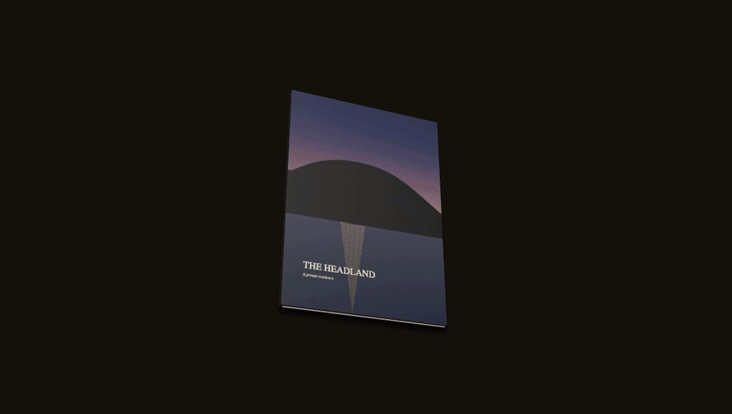

# @vectoad/luxebook-react

**Turn any PDF into a realistic 3D book, in one React component.**

[](https://www.npmjs.com/package/@vectoad/luxebook-react) [](https://github.com/Vectoad/luxebook/blob/main/LICENSE)

**[✨ Live demo](https://vectoad.github.io/luxebook/)** · **[GitHub](https://github.com/Vectoad/luxebook)**

[](https://vectoad.github.io/luxebook/)

Hard or soft covers, paper thickness, matte/silk/glossy pages, four lighting moods, drag-to-turn corners, reading zoom, mobile single-page layout, and your own content on any page. Free, MIT, no watermark.

```sh
npm install @vectoad/luxebook-react
```

```tsx
import { LuxeBook } from "@vectoad/luxebook-react";

export default function Brochure() {
  return (
    <LuxeBook
      source="/brochure.pdf"
      height={600}
      options={{ lighting: "warm", paper: "glossy", coverStyle: "hard" }}
      onReady={(info) => console.log(info)}
      onPageChange={(e) => console.log(e.spread)}
    />
  );
}
```

- React 18. Server-side rendering safe: the 3D engine loads in the browser only.
- `source` is a URL or the PDF bytes.
- `options` covers appearance (background, cover, thickness, paper, lighting, zoom, rotation), layout (`"auto" | "single" | "double"`), and preview mode (`lastPage`).
- `overlay` puts your own React content (a contact form, for example) on a page.
- A `ref` gives you `next()`, `previous()`, `goToPage()`, `open()`, `close()` and `zoomTo()`.

Types for every option are included. Not using React? See [`@vectoad/luxebook-core`](https://www.npmjs.com/package/@vectoad/luxebook-core).

MIT license. Source: https://github.com/Vectoad/luxebook
